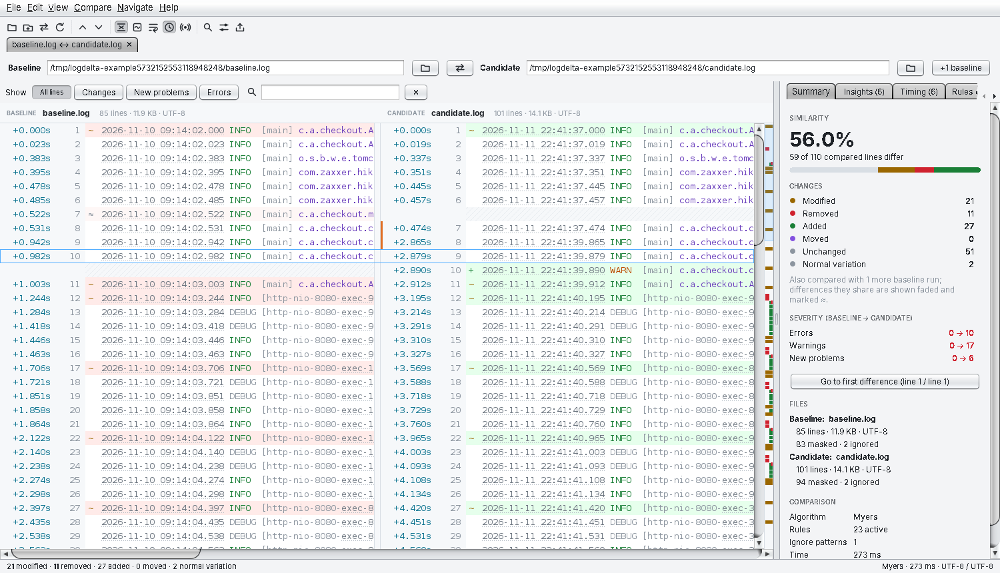
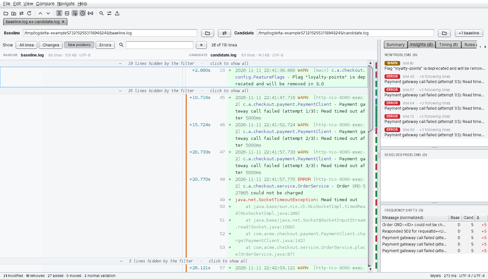
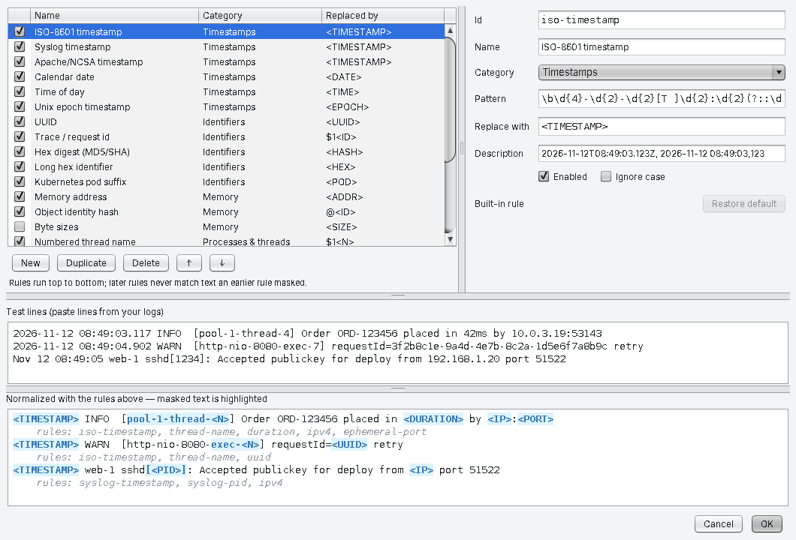

# LogDelta

**Compare two log files while ignoring what always changes.**

You have a log from a run that worked and a log from a run that broke. A plain `diff` is useless:
every line differs because of timestamps, request ids, thread numbers, memory addresses and
durations. LogDelta masks those run-specific values first, then diffs what is left, so the only
differences you see are the ones that matter. It also tells you which **new errors** appeared,
which messages suddenly **repeat far more often** (retry loops!), which **phases got slower**, and
where the two runs **first diverged**.



- **Desktop app** (Swing, light and dark themes) with tabs, a side-by-side view, word-level
  highlights, syntax colouring, filters, bookmarks, live tail and a live rule editor.
- **Command line** with side-by-side, unified, summary, HTML, JSON, Markdown and JUnit output, and
  `logdelta check`, a CI gate that fails only on *new* problems.
- **GitHub Action** that comments the summary on pull requests.
- **Zero dependencies.** Plain Java 25 (LTS). One jar runs both; native installers bundle Java.

---

## Contents

- [Features](#features)
- [Quick start](#quick-start)
- [Using the desktop app](#using-the-desktop-app)
- [Using the command line](#using-the-command-line)
- [Continuous integration](#continuous-integration)
- [Normalization rules](#normalization-rules)
- [Profiles](#profiles)
- [Reports](#reports)
- [How it works](#how-it-works)
- [Performance](#performance)
- [Building from source](#building-from-source)
- [Project layout](#project-layout)
- [Contributing](#contributing)
- [License](#license)

## Features

**Comparison**
- 23 built-in normalization rules: ISO/syslog/Apache timestamps, dates, times, epochs, UUIDs,
  trace/request ids, hashes, hex ids, Kubernetes pod names, memory addresses, Java identity
  hashes, thread names, pids, IPv4/IPv6, ephemeral ports, durations, temp paths, and more
  ([full list](docs/RULES.md)).
- Custom rules with capture-group replacements (`(amount=)\d+` &rarr; `$1<AMOUNT>`).
- Ignore patterns to drop noisy lines entirely (health checks, heartbeats).
- Case- and whitespace-insensitive comparison.
- Two diff algorithms: **Myers** (shortest edit script, linear space, with a cost limit for huge
  inputs) and **Patience** (anchors on unique lines; reads better when blocks move).
- Smart pairing of modified lines: removed and added lines are paired by rarity-weighted
  similarity, so a changed line sits next to its old version and unrelated lines don't.
- Word-level highlights inside modified lines. Masked values never count as changes.
- Moved-line detection.
- **Several baselines**: give more than one good run, and differences that good runs also show
  are treated as normal variation instead of changes.
- **Multi-line entries**: a log line and its stack trace can be compared as one unit.
- **Folders**: compare every log in two folders, pairing rotated names
  (`app-2026-11-02.log` ↔ `app-2026-11-03.log`).
- Reads `.gz` files transparently, downloads `http(s)` URLs, takes pasted text. Detects UTF-8,
  UTF-16 (BOM) and Latin-1.

**Insights**
- **New problems**: warnings, errors, exceptions and stack traces that only appear in the
  candidate, grouped (a stack trace is one item, not twenty).
- **Resolved problems**: errors that disappeared.
- **Frequency shifts**: messages whose count changed sharply, e.g. `0 → 5`
  `Payment gateway call failed`.
- **First divergence**: where the runs stop matching.
- **Timing**: run durations and the phases between matching lines that got slower or faster
  (`132 ms → 15.1 s` between "Validating cart" and "Responded 502").
- **Suggested rules**: "14 lines differ only in the value of `session`", with the mask that
  hides it.

**Desktop app**
- Side-by-side view that stays fast with hundreds of thousands of lines (only visible rows are
  painted), in tabs.
- Filter to only changes, only new problems or only errors, or by text; wrap long lines.
- Syntax colouring of timestamps, levels, threads and logger names; an elapsed-time column
  ("5.2 s into the run") and bars beside phases that got slower.
- Bookmarks with notes, saved with the comparison as a session file.
- Live tail for logs that are still being written.
- Collapsible unchanged regions with adjustable context.
- Overview ruler showing every change in the file; click to jump.
- Toggle between original and normalized text. Hover a masked value to see which rule masked
  it.
- Find across both logs (plain text or regex, case-sensitive or not).
- Rule editor with a live tester: paste lines from your logs and watch them normalize.
- "Ignore lines like this" and "Test line in rule editor" from the context menu.
- Suggested rules apply with one click.
- Folder comparison: a table of files, worst first; double-click opens a pair.
- Open from files, URLs or the clipboard; drag and drop, recent comparisons, zoom,
  light/dark/system themes, a first-run tour.
- Export to HTML, Markdown, JSON, JUnit XML or unified diff; copy a Markdown summary for a ticket.

**Command line**
- Side-by-side (colour), unified, summary, HTML, JSON, Markdown and JUnit XML output.
- Exit codes `0` (same), `1` (different), `2` (error), with `--exit-code problems` to fail a CI
  job only when new warnings or errors appear.
- `check`: compare with known-good baselines, fail only on new problems, keep a rolling folder
  of accepted runs, write JUnit XML and GitHub annotations.
- `normalize`, `explain` and `rules` sub-commands for building and debugging rules.

## Quick start

The easiest way is an installer from the releases page (Windows, macOS, Debian/Ubuntu,
Fedora): it includes Java. See [docs/INSTALLING.md](docs/INSTALLING.md).

To run the jar or build from source you need **Java 25 or newer** (`java -version`). Free
builds: [Adoptium Temurin](https://adoptium.net) or [Oracle JDK](https://www.oracle.com/java/technologies/downloads/).

```sh
# Build (see "Building from source" if you don't have Maven)
mvn -q package -DskipTests

# Open the desktop app
java -jar logdelta-app/target/logdelta-1.1.0.jar

# ...or compare from the terminal
java -jar logdelta-app/target/logdelta-1.1.0.jar examples/baseline.log examples/candidate.log
```

In the app, click **Try the example** to load the bundled logs of a checkout service whose payment
gateway started timing out. The first start also offers a one-minute tour.

A shell alias makes the CLI pleasant to use:

```sh
alias logdelta='java -jar /path/to/logdelta-1.1.0.jar'
```

## Using the desktop app



1. Drop two log files on the window, or use **File > Open Logs** and select both. The first
   file is the **baseline** (known good, left), the second the **candidate** (right). URLs,
   pasted text and whole folders work too. **+ Baselines** adds more good runs.
2. LogDelta jumps to the first difference. **F7 / Shift+F7** move between changes; **F8 /
   Shift+F8** move between new problems. The filter bar (**Alt+1…4**) shows only changes, new
   problems or errors.
3. The sidebar has five tabs:
   - **Summary**: similarity, change counts, errors and warnings before and after, file details.
   - **Insights**: new and resolved problems and frequency shifts. Click any entry to jump to it.
   - **Timing**: run durations and the phases that got slower.
   - **Rules**: suggested rules, comparison options, rules and ignore patterns. Changes apply
     immediately.
   - **Notes**: your notes and bookmarks (**Ctrl+B**).
4. Something still differs that shouldn't? Apply a suggested rule, or right-click the line and
   choose **Ignore Lines Like This** or **Test Line in Rule Editor**.
5. **File > Save Session** keeps the comparison with your notes; **File > Export** writes a
   report; **File > Copy Summary as Markdown** is handy for tickets.



See the [user guide](docs/USER_GUIDE.md) for every feature and keyboard shortcut.

## Using the command line

```text
$ logdelta -f summary -p examples/checkout.ldprofile examples/baseline.log examples/baseline-2.log examples/candidate.log
LogDelta  baseline.log → candidate.log
  also compared with 1 more baseline run(s); 2 difference(s) they explain count as normal

  Similarity        56.0%
  Changes           21 modified  11 removed  27 added  0 moved
  Lines             85 → 101  (2 / 2 ignored)
  First divergence  baseline line 1, candidate line 1
  Errors            0 → 10  Warnings 0 → 17

New problems (6)
  WARN  L10     Flag "loyalty-points" is deprecated and will be removed in 3.0
  ERROR L45     Payment gateway call failed (attempt 1/3): Read timed out after 5000ms (+8 lines)
  ...

Frequency shifts (occurrences baseline → candidate)
     +5     0 → 5     Order ORD-<ID> could not be charged
     +5     0 → 5     Responded 502 for requestId=<UUID> in <DURATION>
     ...

Timing (run duration 6.55 s → 1 min 23 s)
  114.2x    132 ms → 15.1 s    Validating cart for ORD-653708 with 5 items → Responded 502 for …
    5.8x    411 ms → 2.39 s    Loading price cache... → Warmed price cache with 1204 entries in…

Suggested rules (would hide run-specific differences)
   14  differ only in the value of `session`
       --mask '(\bsession\s*[=:]\s*["'\'']?)[^\s,;"'\'')\]}]+=>$1<SESSION>'
```

Common invocations:

```sh
logdelta good.log bad.log                          # side-by-side on a terminal, unified when piped
logdelta -f summary run1.log.gz run2.log.gz        # just the findings
logdelta good-1.log good-2.log bad.log             # two good runs: ignore normal variation
logdelta logs/release-41 logs/release-42           # every log in two folders
logdelta https://ci.example.com/41/app.log app.log # URLs work as inputs (-H for headers)
logdelta -I heartbeat -I '^DEBUG' a.log b.log      # leave out noisy lines
logdelta -m 'ORD-\d+=>ORD-<ID>' a.log b.log        # add a mask on the fly
logdelta -o report.html a.log b.log                # format follows the extension
logdelta --exit-code problems -q a.log b.log       # fail only on new warnings/errors
logdelta check -b expected.log --report junit:out.xml build/app.log   # the CI gate
logdelta explain "2026-11-12 08:49:03 pid=42 took 3ms"   # which rules match?
logdelta normalize app.log | sort | uniq -c | sort -rn   # top message templates
logdelta rules --disable epoch --export team.ldprofile    # start a shared profile
```

The full option reference is in [docs/CLI.md](docs/CLI.md).

## Continuous integration

`logdelta check` compares a run with one or more known-good runs and **fails only when
something new goes wrong**: a new warning, error or stack trace. Everything else is reported but
does not break the build.

```sh
logdelta check --baseline expected/app.log --report junit:build/logdelta.xml build/app.log
logdelta check --baseline-dir .logdelta/runs --update-on-pass build/app.log   # rolling baseline
```

On GitHub, the action does the same and comments the summary on the pull request:

```yaml
- uses: Yeongwonhan-Jeolmang/logdelta@v1.1.0
  with:
    baseline: tests/expected/app.log
    candidate: build/app.log
```

See [docs/GITHUB_ACTION.md](docs/GITHUB_ACTION.md) for inputs, outputs and recipes.

## Normalization rules

A rule is a regular expression plus a replacement. Rules run top to bottom, and a later rule
never matches inside text an earlier rule already replaced. Built-in rules can be switched on
and off; custom rules can be added in the GUI, in a profile, or with `--mask`.

```text
2026-11-12 08:49:03.117 INFO [pool-1-thread-4] Order 3f2b8c1e-9a4d-4e7b-8c2a-1d5e6f7a8b9c took 42ms
<TIMESTAMP> INFO [pool-1-thread-<N>] Order <UUID> took <DURATION>
```

See [docs/RULES.md](docs/RULES.md) for the catalogue and tips on writing rules.

## Profiles

A profile is a small text file that stores options, ignore patterns and rules, so a team can
share one setup between the CLI, the GUI and CI:

```ini
[options]
algorithm = patience
ignore-whitespace = true

[ignore]
pattern = Heartbeat - heartbeat ok

[rule order-id]
name = Order number
pattern = ORD-\d{6}
replacement = ORD-<ID>
```

Use it with `-p team.ldprofile` or **File > Load Profile**. Format: [docs/PROFILES.md](docs/PROFILES.md).

## Reports

| Format | Use it for |
|---|---|
| HTML | A self-contained page (no external assets) with summary, insights and a side-by-side diff. Attach it to a ticket or keep it as a CI artifact. |
| JSON | Automation. Versioned schema with stats, insights and hunks. |
| Markdown | Pull requests and chat. Overview table, problems, shifts and the first hunks. |
| JUnit XML | CI test views: each new problem is a failing test. |
| Unified diff | Reading in any diff viewer or code review tool. |

Details and the JSON schema are in [docs/REPORTS.md](docs/REPORTS.md).

## How it works

```text
read (file/URL, gzip/charset) → drop ignored lines → normalize (rules) + parse timestamps
     → intern keys → diff (Myers/Patience, optionally by multi-line entry) → pair modified lines
     → detect moves → mark normal variation (extra baselines) → word-level highlights
     → insights, timing, rule suggestions → view / report
```

Lines are compared by their **comparison key**: the normalized text, optionally lower-cased and
with whitespace collapsed. Keys are mapped to integers, so the diff algorithms compare ints, not
strings. [docs/ARCHITECTURE.md](docs/ARCHITECTURE.md) explains each stage and the design decisions
behind it.

## Performance

Measured on a 2-core cloud VM with two 33 MB logs of 300,000 lines each (every line masked by
several rules): about 12 seconds end to end, almost all of it regex normalization. Normalization
runs in parallel, so it scales with CPU cores. Logs of a few thousand lines compare in well under
a second. The diff itself handles hundreds of thousands of lines in milliseconds when the logs
are mostly similar; a cost limit keeps very different inputs fast (`--minimal` turns it off).

## Building from source

With Maven 3.9+ and JDK 25+:

```sh
mvn verify                   # compile, run all tests, build the jars
```

The all-in-one jar is `logdelta-app/target/logdelta-1.1.0.jar`. Each module also produces its
own jar.

Without Maven, only a JDK is needed (tests are not run):

```sh
./scripts/build-without-maven.sh          # Linux/macOS → dist/logdelta.jar
scripts\build-without-maven.ps1           # Windows PowerShell
```

Native installers with a bundled runtime (about 60 MB installed) are built with `jpackage`:

```sh
./scripts/package.sh               # deb, dmg or msi for this system
./scripts/package.sh app-image     # portable folder
```

See [docs/INSTALLING.md](docs/INSTALLING.md).

## Project layout

```text
logdelta/
├── logdelta-core/   engine: reading, rules, diff algorithms, analysis, reports, profiles
├── logdelta-cli/    command-line interface (depends on core)
├── logdelta-gui/    Swing desktop application (depends on core)
├── logdelta-app/    launcher + all-in-one jar (depends on cli and gui)
├── examples/        sample logs (two good runs, one bad) and a profile
├── docs/            user guide, CLI reference, rules, profiles, sessions, reports, CI, architecture
├── packaging/       installer icons and jpackage settings
├── scripts/         builds without Maven, installer packaging
└── action.yml       the GitHub Action
```

`logdelta-core` has no dependencies and no UI code, so it can be embedded in other tools or tests:

```java
DiffResult r = new LogDeltaEngine().compare(Path.of("good.log"), Path.of("bad.log"), DiffOptions.defaults());
if (!r.insights().newProblems().isEmpty()) {
    Reports.writeFile(r, ReportFormat.HTML, ReportOptions.DEFAULT, Path.of("logdelta.html"));
}
```

## Contributing

Bug reports, rule ideas and pull requests are welcome. See [CONTRIBUTING.md](CONTRIBUTING.md).

## License

Copyright © 2026 [Hana Eun-Seo](https://github.com/Yeongwonhan-Jeolmang)

LogDelta is free software: you can redistribute it and/or modify it under the terms of the
[GNU General Public License](LICENSE) as published by the Free Software Foundation, either
version 3 of the License, or (at your option) any later version.

LogDelta is distributed in the hope that it will be useful, but WITHOUT ANY WARRANTY; without
even the implied warranty of MERCHANTABILITY or FITNESS FOR A PARTICULAR PURPOSE. See the
GNU General Public License for more details.
