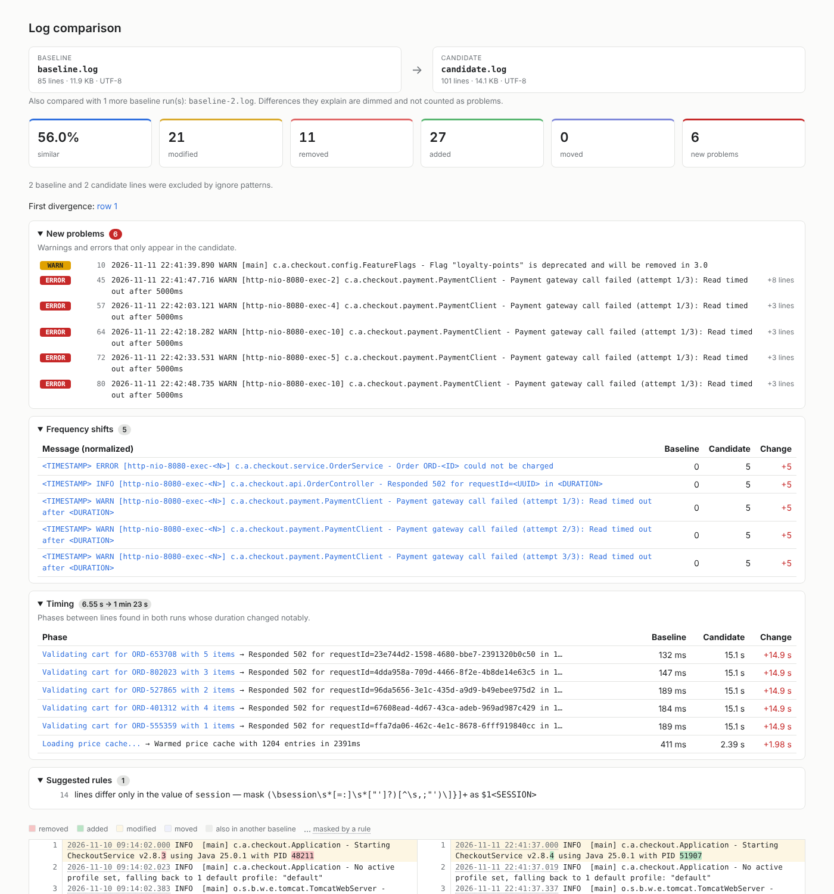

# Reports

LogDelta writes five report formats, from the CLI (`-f FORMAT`, `-o file.ext` or
`--report FORMAT:file`) and from the GUI (**File > Export**). All reports show original lines
(not normalized ones) and use original line numbers.

When a comparison used [more than one baseline](CLI.md#inputs), every report says so, and
differences the other baselines explain are labelled as normal variation instead of being
counted as changes.

## HTML



A single self-contained file: styles and the small expand/collapse script are inline, and there
are no external fonts, images or scripts. It renders anywhere, offline, and can be archived as a
CI artifact or attached to a ticket.

Contents:
- the two files with size, line count and encoding;
- summary cards (similarity, modified, removed, added, moved, new problems);
- insights: first divergence, new and resolved problems, frequency shifts (each links to its row),
  slower phases and suggested rules;
- a side-by-side table of all change blocks with word-level highlights. Masked values are
  underlined, and hovering one shows the rule that masked it.

With `--full` (the GUI always uses it) the unchanged regions between blocks are included but
collapsed. Click a fold to expand it. The page follows the reader's light or dark preference.

## Markdown

A compact summary for pull requests, issues and chat: an overview table, the first divergence,
new and resolved problems, frequency shifts, a timing table, suggested rules, and the first ten
change blocks as `diff` code blocks. In the GUI, **File > Copy Summary as Markdown** puts it on
the clipboard. The [GitHub Action](GITHUB_ACTION.md) posts it as a pull-request comment.

## JUnit XML

For CI test views (GitHub, GitLab, Jenkins, Azure DevOps and others understand it). It follows
the rule of `logdelta check`: only *new problems* fail.

- Each new problem is a failing `<testcase>` named after its message, e.g.
  `ERROR at line 45: Payment gateway call failed (attempt 1/3)`, so failures are listed and
  tracked individually. The failure body is the full first line of the problem.
- Without new problems there is one passing test case, `no new problems`.
- Similarity, change counts and the number of resolved problems are `<property>` elements; run
  durations and slower phases go to `<system-out>`.
- For a folder comparison, each file is its own `<testsuite>`; files that could not be read are
  `<error>`s and binary files `<skipped>`.

```xml
<testsuites name="logdelta" tests="6" failures="6" errors="0" time="0.204">
  <testsuite name="logdelta: candidate.log" tests="6" failures="6" errors="0" skipped="0" time="0.204">
    <properties>
      <property name="baseline" value="baseline.log"/>
      <property name="similarity" value="0.5604"/>
      ...
    </properties>
    <testcase classname="logdelta.candidate.log" name="WARN at line 10: Flag &quot;loyalty-points&quot; is deprecated ...">
      <failure type="NewProblem" message="New WARN in candidate line 10">2026-11-11 22:41:39.890 WARN ...</failure>
    </testcase>
    ...
    <system-out>Similarity 56.0%, 59 unexpected change(s), 2 expected. ...</system-out>
  </testsuite>
</testsuites>
```

## Unified diff

The familiar `---`/`+++`/`@@` format, readable by any diff viewer. Within a block of changes, all
removals are listed before all additions. Hunk headers use original line numbers. When ignore
patterns removed lines, the counts may not add up to the line-number gap, so the output is meant
for reading, not for `patch`.

## Secrets in reports

Every exported report (HTML, Markdown, JSON, JUnit, unified diff, folder reports, `check`
annotations and job summaries) passes through the redactor first. It replaces passwords,
`Authorization` headers, bearer tokens, JWTs, private-key blocks, credentials in URLs,
`password=`/`secret=`/`token=`/`api_key=` values, cloud and SaaS keys (AWS, GitHub, GitLab, Slack,
Google, Stripe, npm, `sk-…`) and e-mail addresses with `[REDACTED]`, and says how many were
removed. Terminal output and the app's own view are not changed.

- `--no-redact` (or `redact = false` in a profile, or **Export > Remove Secrets from Exports**
  in the app) turns the built-in detectors off.
- `--redact REGEX` (repeatable, or `[redact]` `pattern = …` lines in a profile) adds your own;
  they apply even with `--no-redact`.
- `logdelta rules --redaction` lists the detectors.

Redaction is a safety net, not a guarantee: review a report before you publish it.

## JSON

Stable, versioned output for automation. Example (abridged):

```json
{
  "schemaVersion": 1,
  "tool": { "name": "LogDelta", "version": "2.0.0" },
  "left":  { "name": "baseline.log", "path": "/runs/1/baseline.log", "lines": 83, "bytes": 11582, "charset": "UTF-8", "gzip": false, "firstLine": 1 },
  "right": { "name": "candidate.log", "path": "/runs/2/candidate.log", "lines": 101, "bytes": 14432, "charset": "UTF-8", "gzip": false, "firstLine": 1 },
  "extraBaselines": [ { "name": "baseline-2.log", "path": "/runs/0/baseline-2.log", "lines": 85 } ],
  "options": {
    "algorithm": "myers", "minimal": false, "ignoreCase": false, "ignoreWhitespace": true, "detectMoves": true,
    "multilineEntries": false, "logFormat": "auto", "preset": "auto",
    "ignoreFields": ["@timestamp", "timestamp", "time", "ts", "..."],
    "timeWindow": { "since": "+2m", "until": null },
    "ignorePatterns": ["Heartbeat - heartbeat ok"],
    "enabledRules": ["order-id", "amount", "iso-timestamp", "..."]
  },
  "detected": { "format": "plain", "preset": "spring-boot" },
  "stats": {
    "identical": false, "similarity": 0.5604, "unchanged": 51, "modified": 21, "removed": 11, "added": 27,
    "moved": 0, "expected": 2, "leftIgnored": 2, "rightIgnored": 2, "leftMasked": 83, "rightMasked": 94,
    "elapsedMillis": 190
  },
  "insights": {
    "firstDivergence": { "row": 0, "leftLine": 1, "rightLine": 1 },
    "newProblems": [
      { "line": 44, "severity": "ERROR", "text": "2026-11-11 22:41:37.919 WARN ...", "groupedLines": 9, "occurrences": 15 }
    ],
    "resolvedProblems": [],
    "severity": { "error": { "left": 0, "right": 10 }, "warn": { "left": 0, "right": 16 }, "...": {} },
    "frequencyShifts": [
      { "template": "<TIMESTAMP> ERROR [...] Order ORD-<ID> could not be charged", "left": 0, "right": 5, "delta": 5 }
    ],
    "templateShifts": [
      { "template": "Payment gateway call failed (attempt <*> Read timed out after <DURATION>",
        "severity": "WARN", "left": 0, "right": 15, "delta": 15, "variants": 3 }
    ],
    "flakyLines": [
      {
        "kind": "values", "line": 1, "text": "... Starting CheckoutService v2.8.3 ... with PID 48211",
        "varyingRuns": 1, "totalRuns": 2, "similarLines": 0,
        "rules": [ { "id": "number-after-pid", "pattern": "(\\bPID\\s+)\\d+(?:\\.\\d+)?\\b", "replacement": "$1<N>" } ]
      }
    ]
  },
  "timing": {
    "available": true, "leftDurationMillis": 6548, "rightDurationMillis": 83101,
    "slower": [
      {
        "leftMillis": 132, "rightMillis": 15068,
        "from": { "leftLine": 59, "rightLine": 71, "text": "... Validating cart for ORD-653708 with 5 items" },
        "to":   { "leftLine": 62, "rightLine": 76, "text": "... Responded 502 for requestId=... in 15062ms" }
      }
    ],
    "faster": []
  },
  "problemTimeline": {
    "byTime": true, "spanMillis": 83101,
    "left":  { "warnings": [0, 0, "... 60 bins"], "errors": [0, 0, "..."] },
    "right": { "warnings": [0, 3, "..."], "errors": [0, 1, "..."] }
  },
  "suggestedRules": [
    {
      "id": "mask-session", "summary": "differ only in the value of `session`",
      "pattern": "(\\bsession\\s*[=:]\\s*[\"']?)[^\\s,;\"')\\]}]+", "replacement": "$1<SESSION>", "resolves": 14
    }
  ],
  "redactedSecrets": 0,
  "hunks": [
    {
      "rows": [
        {
          "kind": "modified",
          "left":  { "line": 1, "text": "... v2.8.3 ... PID 48211", "normalized": "<TIMESTAMP> ...", "changed": [[78, 84]] },
          "right": { "line": 1, "text": "... v2.8.4 ... PID 51907", "normalized": "<TIMESTAMP> ...", "changed": [[78, 84]] }
        },
        { "kind": "added", "left": null, "right": { "line": 8, "text": "..." } },
        {
          "kind": "modified", "left": { "line": 9, "text": "{\"level\":\"info\",\"user\":\"a\"}" }, "right": { "...": "..." },
          "fieldChanges": [ { "field": "level", "left": "info", "right": "error" } ]
        }
      ]
    }
  ]
}
```

| Field | Notes |
|---|---|
| `stats.similarity` | `2 * unchanged / (left compared lines + right compared lines)`, from 0 to 1 |
| `stats.removed` / `added` | include moved lines; subtract `moved` for true removals/additions |
| `stats.expected` | changed rows that another baseline explains; `identical` ignores them |
| `hunks[].rows[].expected` | `true` on such rows |
| `timing` | `available` is `false` when either log lacks timestamps; durations are in milliseconds |
| `suggestedRules` | rules that would hide run-specific differences; `resolves` is the number of modified lines they would make equal |
| `insights.*.groupedLines` | consecutive problem lines (e.g. a stack trace) are reported as one item |
| `hunks[].rows[].kind` | `unchanged`, `modified`, `removed`, `added` |
| `...changed` | `[start, end)` character ranges of word-level changes in `text` |
| `...normalized` | present only when rules changed the line |
| `left.firstLine` / `right.firstLine` | line number of the first line read; greater than 1 with `--since` |
| `detected` | format (`plain`, `json`, `logfmt`) and preset (`null` for none) actually used, after auto-detection |
| `insights.*Problems[].occurrences` | how many lines with the same message (numbers and ids masked) the item stands for |
| `insights.templateShifts` | message templates (`<*>` marks a varying word) whose count changed; `variants` is the number of distinct messages it covers |
| `insights.flakyLines` | lines that differ between good runs; `kind` is `values` (a part varies, `rules` mask it) or `presence` (the line comes and goes, `ignorePattern` hides it); `similarLines` more lines would be fixed by the same rules |
| `problemTimeline` | warnings and errors in 60 equal bins of time (`byTime`, bin width `spanMillis / 60`) or, without timestamps, of line position |
| `redactedSecrets` | number of secrets replaced by `[REDACTED]` in this report (0 with `--no-redact`) |
| `hunks[].rows[].fieldChanges` | for JSON/logfmt lines: the fields whose value differs (`null` when the field is missing on that side) |
| `movedFromOrToLine` | present on moved lines: the line number of the counterpart on the other side |

`schemaVersion` increases only on incompatible changes. New fields may be added at any time.

### Folder comparisons

Comparing two folders produces `"kind": "folder"` and one entry per file:

```json
{
  "schemaVersion": 1,
  "kind": "folder",
  "left": "/runs/41/logs", "right": "/runs/42/logs",
  "elapsedMillis": 405, "newProblems": 9,
  "files": [
    {
      "name": "app.log", "left": "/runs/41/logs/app.log", "right": "/runs/42/logs/app.log",
      "status": "changed", "similarity": 0.2258, "changes": 103, "expected": 0, "resolvedProblems": 0,
      "newProblems": [ { "line": 10, "severity": "warn", "lines": 1, "text": "..." } ]
    },
    { "name": "crash.log", "left": null, "right": "/runs/42/logs/crash.log", "status": "only_right", "newProblems": [ ... ] }
  ]
}
```

`status` is one of `identical`, `changed`, `only_left`, `only_right`, `skipped` (binary) and
`failed` (with a `message`). Files are ordered for review: most new problems first. Folder
comparisons support the Markdown (a table), JSON and JUnit formats; HTML and unified diffs
describe a single pair of logs.
