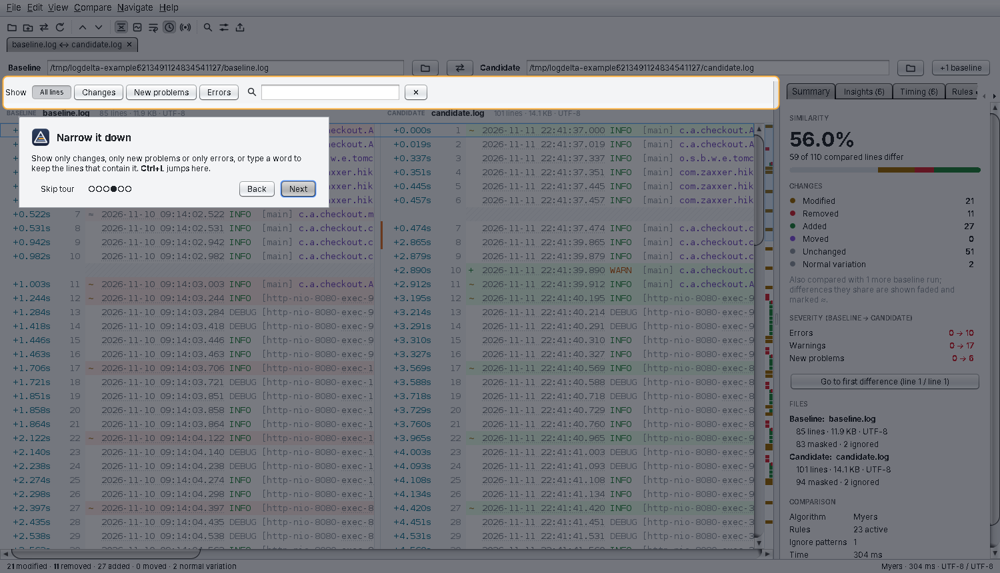
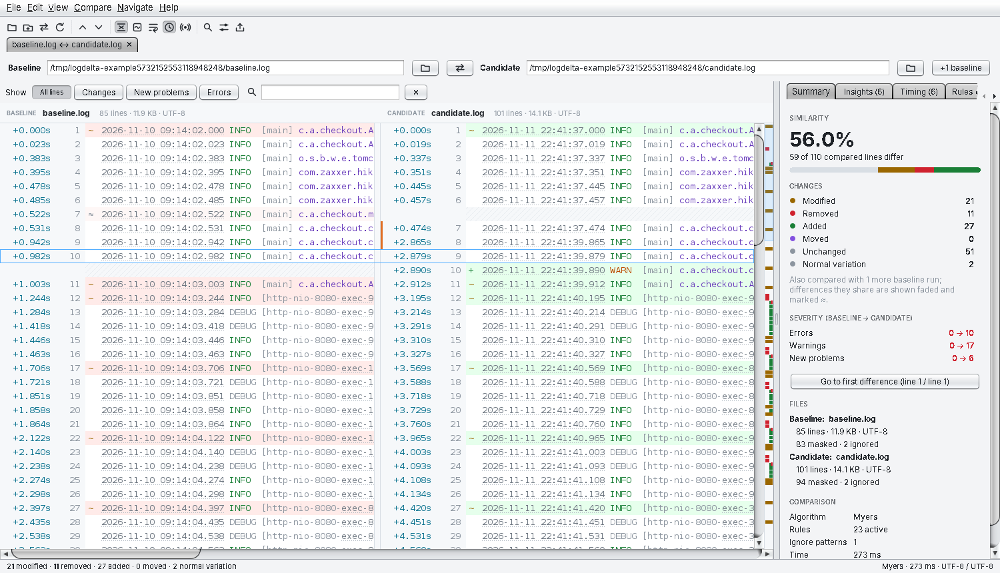
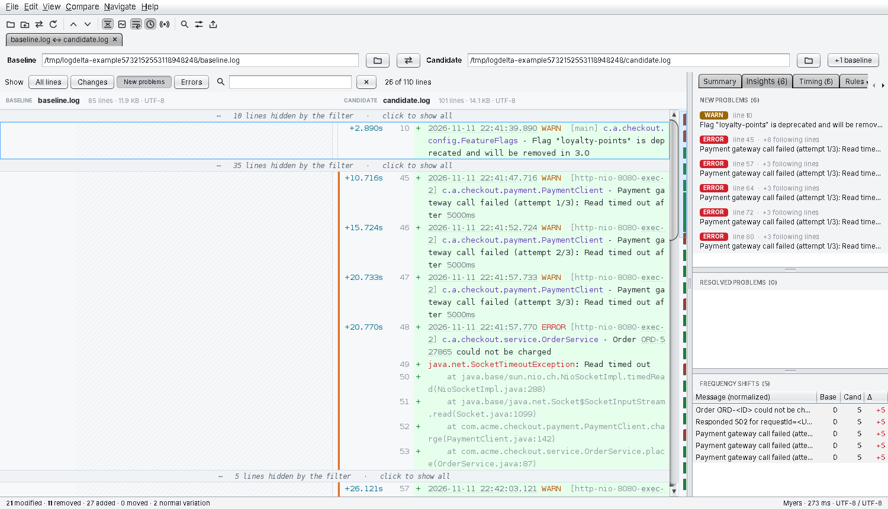
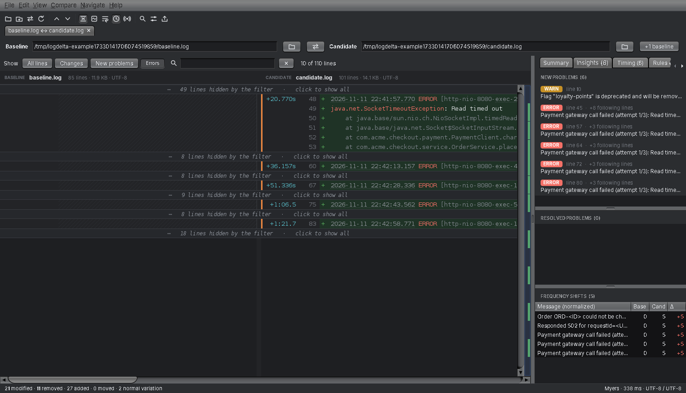
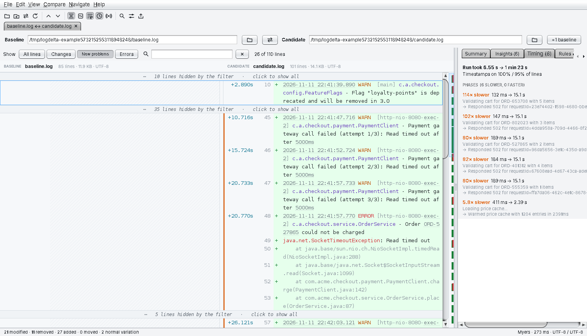
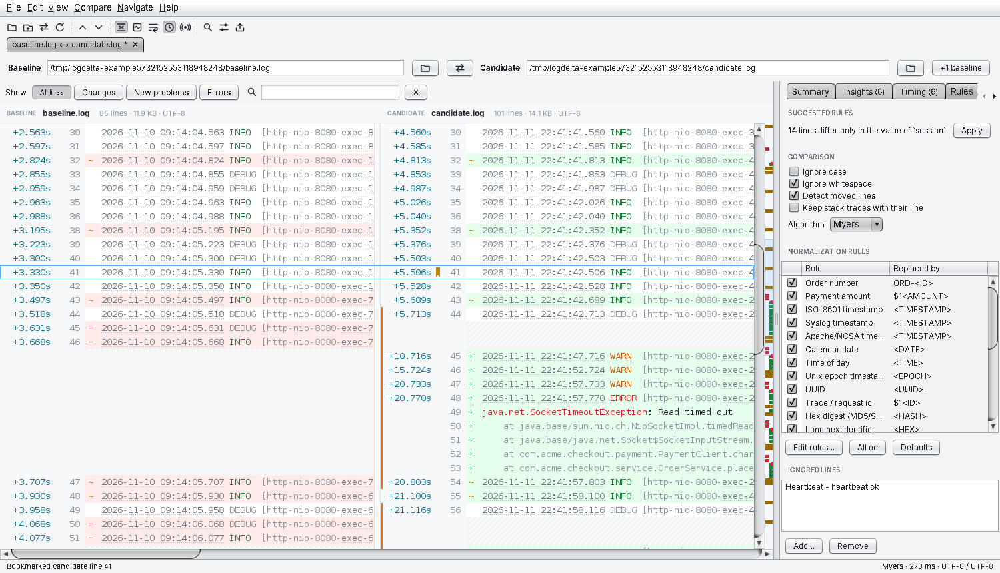
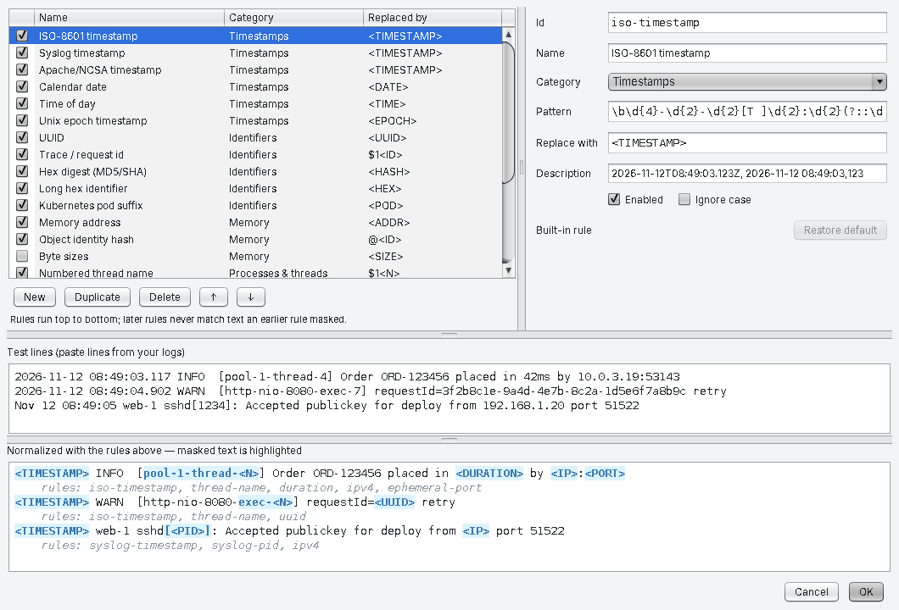
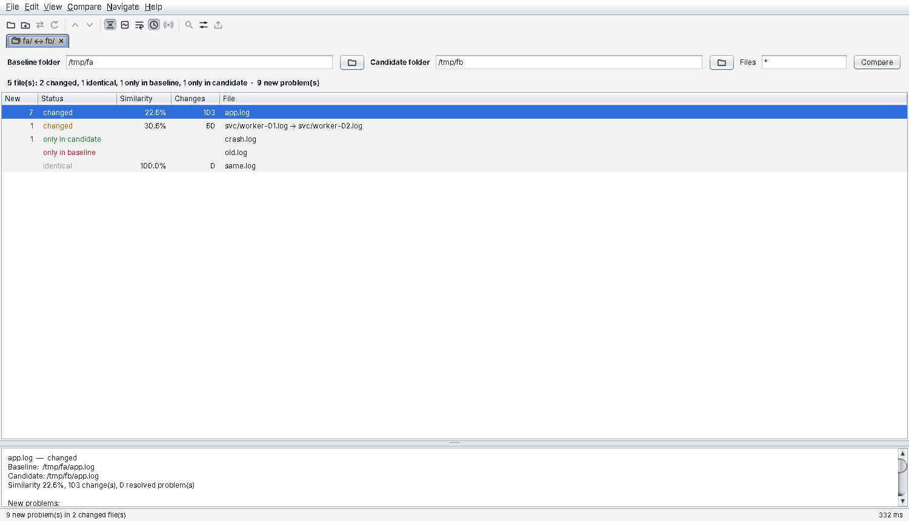

# Desktop app guide

Start the app from the installer's menu entry, or with `java -jar logdelta-2.0.0.jar` (or
double-click the jar). To open something right away:

```sh
java -jar logdelta-2.0.0.jar gui baseline.log candidate.log            # two logs
java -jar logdelta-2.0.0.jar gui good-1.log good-2.log candidate.log   # several good runs
java -jar logdelta-2.0.0.jar gui logs/release-41 logs/release-42       # two folders
java -jar logdelta-2.0.0.jar gui review.ldsession                      # a saved session
```

On the first start a short tour points out the main parts of the window: the window is dimmed
except for a spotlight on one part at a time, with a card that explains it. **Help > Take the
Tour** shows it again; Esc skips it.



## Opening logs

- **Drag and drop** two files anywhere on the window. The first becomes the baseline (left) and
  the second the candidate (right). Dropping one file fills the empty side, or replaces the
  candidate. Dropping three or more files uses the extra ones as further baselines; dropping two
  folders compares the folders; dropping a `.ldsession` file opens it.
- **File > Open Logs** (Ctrl+O): select both files in one dialog.
- Type or paste a path **or an `http(s)` URL** into the **Baseline** or **Candidate** field and
  press Enter.
- **File > Open URLs** (Ctrl+Shift+O): baseline and candidate URLs, with an optional request
  header (for example `Authorization: Bearer …` for a CI server). The header is kept in memory
  only. A URL on the clipboard is pre-filled.
- **File > Paste as Candidate** (Ctrl+Shift+V) / **Paste as Baseline**: use the clipboard text,
  for logs copied out of a terminal, a ticket or a chat.
- **Swap** (Ctrl+Shift+S, or the ⇄ button) exchanges the sides.
- **File > Open Recent** and the welcome screen list your last ten comparisons.
- **File > Open Example** loads two bundled runs of a checkout service, a second good run and a
  matching profile.

`.gz` files and downloads are decompressed automatically. Encodings are detected (UTF-8,
UTF-16 with a BOM, otherwise Latin-1).

### Tabs

Every comparison lives in its own tab, so you can keep several open. **File > New Comparison
Tab** (Ctrl+T) opens an empty one, **Close Tab** (Ctrl+W, or the ✕ / middle-click on the tab)
closes it, and Ctrl+PgDn / Ctrl+PgUp switch between tabs. Each tab has its own files, rules,
filter, bookmarks and notes.

### More than one good run

A single good run cannot tell you what varies *normally*: a cache warm-up message that only
sometimes appears, a retry that happens one run in five. Click **+ Baselines** next to the
candidate field (or **Compare > Add Baseline Run**) to add more known-good runs, from files or
URLs. The first baseline is still the one shown side by side, but a difference that any other
good run shows too is now **normal variation**: it is drawn faded with a `≈` marker, it does not
count as a change and it is never a new problem. The Summary tab shows how many differences the
extra runs explained.

## Reading the comparison



| Element | Meaning |
|---|---|
| Red background, `−` | line only in the baseline (removed) |
| Green background, `+` | line only in the candidate (added) |
| Red/green with `~` | the same line, modified; changed words are highlighted more strongly |
| Faded, `≈` | normal variation: another good run differs the same way |
| Purple, `↕` | the line moved; hover the marker to see where it went |
| Hatched side | no line on this side |
| Dotted underline | a value masked by a rule; hover it to see which rule |
| Orange bar at the candidate's edge | the row is inside a phase that got notably slower; hover it |
| Orange flag in the gutter | a bookmark; hover it to read the note |
| `⋯ N unchanged lines` | a collapsed region; click it (or select it and press Enter) to expand |

Timestamps, levels, thread names and logger names are coloured, so the message stands out
(**View > Syntax Colouring** turns this off). Stack-trace frames are dimmed and exception names
are shown in the error colour.

The **overview ruler** to the right of the scroll bar shows every change in the whole file:
removals on the left half, additions on the right, modifications and moves across. Red ticks mark
new problems. Click or drag on it to jump.

The header above each pane shows the file name, line count, size and encoding.

### Elapsed time

**View > Show Elapsed Time** (Alt+T, or the clock button) adds a column with each line's time
since the first timestamp of its log: `+5.203s`, `+1:06.5`. Comparing "5.2 s into the run" on
both sides makes slowdowns obvious even when the two runs happened on different days. Lines
without their own timestamp (stack traces) show nothing.

## Filtering the view

The bar above the comparison narrows what is shown:

- **All lines** (Alt+1): everything; unchanged regions may be collapsed.
- **Changes** (Alt+2): only lines that differ.
- **New problems** (Alt+3): only new warnings and errors, including their stack traces.
- **Errors** (Alt+4): only ERROR and FATAL lines (and exception lines), on either side.
- The **text field** (Ctrl+L) keeps only lines containing the text, on either side, ignoring
  case. It combines with the buttons. Esc clears it.



Hidden runs appear as a single row, "N lines hidden by the filter"; click it to show all lines
again. The bar shows how many lines are visible. Jumping to a hidden row (from Insights, for
example) clears the filter.

## Navigating

| Shortcut | Action |
|---|---|
| F7 / Shift+F7 | next / previous block of changes |
| F8 / Shift+F8 | next / previous new problem |
| F2 / Shift+F2 | next / previous bookmark |
| Alt+Home | first difference |
| ↑ ↓ PgUp PgDn, Ctrl+Home/End | move the selected row |
| ← → or Shift+mouse wheel | scroll both panes horizontally |
| drag the middle divider | give one side more room; double-click it for equal widths |
| Alt+Shift+→ / Alt+Shift+← | widen the baseline / candidate pane |
| Ctrl+F | find in both logs; Enter / Shift+Enter for next / previous match, Esc to close |

The find bar searches the text that is displayed (original or normalized), supports regular
expressions (`.*`) and case-sensitive matching (`Aa`), and expands collapsed regions to show a
match. **Help > Keyboard Shortcuts** (F1) lists every shortcut.

### Command palette

**Ctrl+Shift+P** (⌘⇧P on macOS, or **Help > Command Palette**) opens a search box over every
menu command. Type a few letters of a command's name or its menu (`dark`, `exp html`, `wrap`),
use ↑/↓ and press Enter. Shortcuts and on/off states are shown next to each entry; recently used
commands come first.

## View options

- **Pane Widths**: widen either side or restore equal widths. You can also drag the divider
  between the panes. The position is remembered.
- **Collapse Unchanged Lines** (Ctrl+U) and **Context Lines** control folding. **Expand All**
  (Ctrl+E) opens every fold.
- **Show Normalized Text** (Ctrl+M) displays lines exactly as they are compared, with
  placeholders such as `<TIMESTAMP>`.
- **Wrap Long Lines** (Alt+Z) breaks long lines instead of scrolling sideways; each row grows
  to fit the longer of its two lines.
- **Syntax Colouring** and **Show Elapsed Time**, described above.
- **Theme**: Light, Dark, High Contrast, or System (the platform look and feel). Themes switch
  immediately.
- **Colour-Blind-Safe Colours** replaces red/green with blue/orange for removed and added lines,
  so changes stay distinct with red-green colour blindness. Changes are also marked with
  symbols (`-`, `+`, `~`, `↕`) in the gutter, never by colour alone.
- **Language**: English or 한국어 (Korean); used after the next start.

  

- **Zoom In / Out / Actual Size** (Ctrl+= / Ctrl+- / Ctrl+0) change the editor font.

## The Compare menu

- **Compare Again** (F5) re-reads the sources, keeping the scroll position.
- **Keep Stack Traces with Their Line** compares a log line and its continuation lines (a stack
  trace, a wrapped message) as one entry, so a trace is never matched to the wrong error. The
  same switch is in the Rules tab.
- **Live Tail** (Ctrl+Shift+L, or the ripple button) follows logs that are still being
  written, like `tail -f`: whenever a file changes (URLs are fetched again every five seconds) the
  comparison re-runs and, if you were at the end, the view stays at the end. Combine it with the
  **New problems** filter to watch a test run and see errors appear as they happen. The tab title
  shows ● while live tail is on.
- **Compare Again When Files Change** does the re-comparing for every tab without following the
  end.

## The sidebar

**Summary**: similarity, a bar with the share of each kind of change, counts (including normal
variation), errors and warnings before and after, the detected log format, file details, and a
button to jump to the first difference. The **problems over time** chart shows warnings and
errors along each run (by timestamp, or by position when there are none); a burst in the
candidate that the baseline doesn't have is easy to spot. Click a bar to jump there.

**Insights**: the fastest way to answer "what broke?"

- *New problems*: warnings, errors, exceptions and stack traces that only appear in the
  candidate. Consecutive problem lines are grouped, so a stack trace is one entry.
- *Resolved problems*: problems that no longer appear.
- *Frequency shifts*: messages whose number of occurrences changed sharply. They often point
  at retry loops or a cache that stopped working. Messages that differ only in values are
  grouped into a template (marked `≈`, varying parts shown as `<*>`), so 200 retries for 200
  different orders are one entry, not 200. A problem that occurs many times shows `×N`.



**Timing**: the run durations and the phases that got notably slower or faster. A phase is the
stretch between two lines that match on both sides, for example "Validating cart …" to "Responded
…": `132 ms → 15.1 s` is hard to miss. Phases are reported when they changed by at least 250 ms
and by a factor of 1.5.

**Rules**: suggested rules, flaky lines, the **log format** (auto-detected format and preset,
ignored fields for JSON/logfmt, and a time window), comparison options (ignore case, ignore whitespace, detect moves,
stack traces, algorithm), the rule list with on/off switches, and ignore patterns. Every change
re-compares automatically after a short pause.

**Notes**: free-form notes about the comparison and the list of bookmarks (see below).

Click any entry in a list to jump to it.

## Making noise disappear

When many lines differ only because of one run-specific value (a `session=…`, a tenant id), the
**Rules** tab shows a **suggested rule** at the top, for example "14 lines differ only in the value
of `session`". Hover it to see the pattern and an example; **Apply** adds the rule and the noise
is gone. The Rules tab title shows • while there are suggestions.



With more than one good run, the Rules tab also lists **flaky lines**: lines that already differ
between your good runs (a PID, a port, a line that is only sometimes there). Each has a
**Mask** or **Ignore** button with the rule that fixes it and all similar lines.

**Structured logs.** For JSON lines and logfmt, fields are compared by name, whatever their
order. Hover a modified line to see which fields changed (`status: 200 → 502`). Timestamps and
trace ids are ignored; edit **Ignored fields** in the Rules tab to change that.

**Time window.** Enter `+2m` and `+5m` under **Log format** to compare only minutes two to five
of each run, or absolute times like `08:49`.

For other noise:

1. Right-click the line and choose **Ignore Lines Like This** to drop every line with the same
   message. LogDelta proposes a regular expression in which masked values are wildcards; edit it
   if needed.
2. Or choose **Test Line in Rule Editor** to write a rule that masks just the varying part.



In the **rule editor** (Ctrl+R) you can add, duplicate, delete and reorder rules and edit every
field. The tester at the bottom normalizes the sample lines with the rules exactly as they are in
the editor and lists the rules that matched each line. Invalid patterns are reported immediately
and never applied. **Restore default** resets a modified built-in rule.

Save the result with **File > Save Profile As** to reuse it on the command line or share it.

## Bookmarks, notes and sessions

- **Ctrl+B** (or double-click a line number, or the context menu) bookmarks the selected line;
  press it again to remove the bookmark. The candidate side is used when the row has one.
- **Ctrl+Shift+B** edits the bookmark's note ("first sign of the outage"). Notes show as tooltips
  on the flag and in the **Notes** tab.
- **F2 / Shift+F2** jump between bookmarks.
- The **Notes** tab also has a free-form text area for the comparison as a whole.

**File > Save Session** (Ctrl+S) stores everything about the tab in a small text file
(`.ldsession`): the sources (paths are stored relative to the session file when they are next to
it), extra baselines, rules and options, bookmarks and notes. Pasted logs are saved as files next
to the session. **File > Open Session**, dropping the file on the window, or double-clicking it
(with the installer) restores the tab. Bookmarks remember their line's text as well as its
number, so they stay on the right line when the log is regenerated with a few lines more or
less. The format is described in [SESSIONS.md](SESSIONS.md).

A tab with unsaved bookmarks or notes shows `*` and asks before closing.

## Comparing folders

**File > Compare Folders** (Ctrl+Shift+D), or dropping two folders, opens a folder tab. It lists
every file of the two folders, the ones that need attention first:

| Column | Meaning |
|---|---|
| New | new problems in the candidate file |
| Status | changed, identical, only in baseline, only in candidate, skipped (binary) or failed |
| Similarity / Changes | as for a single comparison |
| File | the relative path; `a-01.log → a-02.log` for files paired by their rotated names |



Files are paired by relative path, and files whose names differ only in digits
(`app-2026-11-02.log`, `app-2026-11-03.log`) are paired too. Files that only exist in the
candidate folder are still scanned for errors. The **Files** field limits the comparison to
matching names, e.g. `*.log` (several patterns separated by commas).

Select a row to see its new problems below the table; **double-click** (or Enter) opens the pair
side by side in a new tab. **File > Copy Summary as Markdown** copies the table.

## Exporting

**File > Export**: HTML report (Ctrl+Shift+E), Markdown summary, JSON, JUnit XML, or unified
diff. HTML exports include the collapsed unchanged regions. **File > Copy Summary as Markdown**
(Ctrl+Shift+C) puts a short summary on the clipboard.

Copy single lines with Ctrl+C (candidate side), or via the Edit and context menus.

Exports have secrets removed (passwords, tokens, API keys, credentials in URLs, e-mail
addresses); the status bar says how many. Switch it off with **File > Export > Remove Secrets
from Exports** if you need the raw text. The view itself is never changed.

## Settings

**Reopen tabs at start** (File menu, on by default): the tabs that were open when you quit,
with their rules, bookmarks and notes, come back on the next start. Tabs are stored as session
files in `~/.logdelta/open-tabs/`.

**Check for updates** (Help menu) asks GitHub whether a newer release exists. **Check
Automatically** does that at most once a day at start; it is off until you switch it on, and
nothing but the request for the latest release is sent.

Window size, theme, font size, folding, wrapping, colouring, the elapsed-time column, the last
folder and recent comparisons are remembered with Java Preferences. The active options and rules
are stored as a normal profile in `~/.logdelta/session.ldprofile`.

## Large files

Comparisons run in the background with a progress bar and a **Cancel** button. Only visible rows
are painted, so scrolling stays smooth for very large files. Big files are memory-mapped and
kept in compact form; the installed app uses up to 75 % of the computer's memory. With the jar,
give it more if memory runs out: `java -Xmx4g -jar logdelta-2.0.0.jar`. A time window (Rules >
Log format) makes huge logs quick, because reading stops at the end of the window.

## Accessibility

- Every button, the comparison view and the charts have names for screen readers; moving the
  selection in the comparison announces the row (`Row 12 of 340, Modified, …`).
- The **High Contrast** theme and **Colour-Blind-Safe Colours** are in the View menu.
- Everything is reachable from the keyboard; the command palette finds any command by name.
